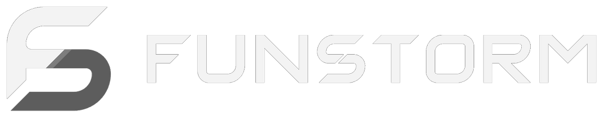

<div align="center">



# FunStorm Vantablack

**Omarchy's Vantablack look and feel on KDE Plasma 6 (Wayland): an all-black desktop with tiling, a top bar, a desktop cube and Omarchy's wallpaper picker.**

[English](#english) • [Русский](#русский)

</div>

---

## English

### What you get

| | |
|---|---|
| **Top bar** | Full width, black glass. Menu, desktops `1 2 3 4 5` (Omarchy style), clock (`Wednesday 17:11`), minimized windows, tray |
| **Colours** | Vantablack scheme (pure black, white text, grey accents), Colloid-Grey-Dark icons, Darkly windows, Inter + JetBrains Mono |
| **Tiling** | Krohnkite: spiral (Hyprland's *dwindle*) and columns (*scrolling*), no gaps, windows never open maximized |
| **Focus** | Like Hyprland: the window under the pointer is active, instantly |
| **Desktops** | 5 desktops. `Alt+1…5` and `Alt+Tab` turn a 3D cube to the desktop and fly in; another key retargets instantly; with `Alt+Tab` you enter when you release `Alt` |
| **Wallpapers** | Omarchy's picker (slanted carousel), opened by **double-clicking the desktop** or `Meta+Ctrl+Space`; new wallpaper appears with Omarchy's slanted reveal animation; images stay at full resolution |
| **Other desktop switches** | Zoom animation (old desktop sinks away, new one comes forward) |
| **Login screen** | Omarchy's SDDM theme with the FunStorm logo, black (optional) |
| **Touchpad** | 3- and 4-finger gestures off (Omarchy-like), via InputActions |
| **Extras** | Glitch close animation, Cover Switch window switcher, Ghostty config |

### Requirements

- Arch-based distro (made on **CachyOS**), **KDE Plasma 6.x on Wayland**
- An AUR helper (`paru` or `yay`) for the AUR packages
- Run the installer **inside your Plasma session as your normal user**

### Quick start

```bash
git clone https://github.com/funstorm15/funstorm-vantablack
cd funstorm-vantablack
./install.sh --dry-run   # see what would change
./install.sh             # asks before every step
```

Put your wallpapers in `~/Pictures/Wallpapers/vantablack` (or set `WALLPAPER_DIR`), then log out and back in once.

| Option | |
|---|---|
| `--dry-run` | print every action, change nothing |
| `--yes` | don't ask (sudo still asks for your password) |
| `--only packages,files,look,kwin,shortcuts,panel,wallpaper,login,splash` | run only these steps |
| `--undo` | restore the configs saved by the last run and remove what it added |

Before changing anything the installer copies your KDE configs to `~/.local/state/funstorm-vantablack/backup-*`.

### Shortcuts

| Keys | Action |
|---|---|
| `Meta` | menu (opens on favorites) |
| `Alt+1…5` | cube to desktop 1–5 |
| `Alt+Tab` | cube; `Tab` again turns further, release `Alt` to enter |
| `Meta+Shift+1…5` | move window to desktop |
| `Meta+C` | open the cube freely |
| `Meta+Tab` | window switcher (Cover Switch) |
| `Meta+W` | close window |
| `Meta+F` | fullscreen on/off |
| `Meta+T` | float / tile window |
| `Meta+Ctrl+L` | switch tiling: spiral ⇄ columns |
| `Meta+Alt+H/J/K/L` | focus left/down/up/right |
| `Meta+Shift+H/J/K/L` | move window left/down/up/right |
| `Meta+Ctrl+←/→/↑/↓` | resize tile |
| `Meta+L` | lock screen |
| `Meta+D` | show desktop |
| `Meta+Ctrl+Space` | wallpaper picker (or double-click the desktop) |
| `Meta+Space` | Konsole |

### Make it yours

- **Logo on the login screen:** replace `sddm/funstorm/logo.png` (transparent PNG, about 1100 px wide) before running the `login` step. The FunStorm logo is the author's brand, please use your own.
- **Wallpaper folder:** `WALLPAPER_DIR=/path ./install.sh --only wallpaper`, or pass a folder to `vantablack-wallpaper /path`.
- **Gestures:** `~/.config/inputactions/config.yaml` ([InputActions docs](https://wiki.inputactions.org)).

### How it works

| Path | What it is |
|---|---|
| `kwin/effects/cubeswitch` | KDE's Cube effect, extended: jump to a desktop by number, `Alt+Tab` with release-to-enter, interruptible, fast |
| `kwin/effects/zoomdesktop` | desktop-switch animation (based on KWin's Fade Desktop) |
| `kwin/scripts/krohnkite-overlay` | smaller Vantablack layout popup + vector icons, laid over your installed Krohnkite |
| `plasma/plasmoids/funstorm.workspaces` | Omarchy-style desktop numbers for the panel |
| `plasma/wallpapers/funstorm.reveal` | wallpaper plugin with Omarchy's slanted reveal transition |
| `share/picker/picker.qml` | Omarchy's image picker ported to plain QtQuick |
| `bin/desktop-dblclick-patch` | adds double-click-to-pick-wallpaper to KDE's desktop; re-applies itself after Plasma updates (at login), falls back to stock if it can't |
| `plasma/panel/layout.js` | builds the top bar through Plasma's scripting API |
| `sddm/funstorm` | Omarchy's SDDM theme, recoloured, FunStorm logo, empty-username fix |

### Troubleshooting

- **Shortcuts don't react:** log out and in once; KWin loads new effects at login.
- **Wallpaper picker is empty:** add images to the wallpaper folder.
- **Login says wrong password right after switching to SDDM:** fixed in this theme (it falls back to the first user when SDDM has no last user yet). If you changed the theme, check `journalctl -u sddm`.
- **Undo everything:** `./install.sh --undo`, then log out and in. The login screen step prints how to go back to your previous display manager.

---

## Русский

### Что внутри

Внешний вид и поведение Vantablack из **Omarchy** на **KDE Plasma 6 (Wayland)**:

- **Панель сверху**, чёрное стекло на всю ширину: меню, рабочие столы `1 2 3 4 5` как в Omarchy, часы, свёрнутые окна, трей.
- **Цвета Vantablack**, значки Colloid-Grey-Dark, окна Darkly, шрифты Inter и JetBrains Mono.
- **Тайлинг** (Krohnkite): «спираль» (dwindle из Hyprland) и «колонки», без отступов.
- **Фокус** следует за мышью мгновенно, как в Hyprland.
- **Куб рабочих столов** на `Alt+1…5` и `Alt+Tab`, с удержанием Alt.
- **Обои:** окно выбора из Omarchy по двойному клику на рабочем столе, анимация смены как в Omarchy.
- **Экран входа SDDM** из Omarchy с логотипом FunStorm (по желанию).
- **Жесты 3 и 4 пальцами** выключены, как в Omarchy.

### Установка

```bash
git clone https://github.com/funstorm15/funstorm-vantablack
cd funstorm-vantablack
./install.sh --dry-run   # посмотреть, что изменится
./install.sh             # спрашивает перед каждым шагом
```

Обои положи в `~/Pictures/Wallpapers/vantablack`, потом один раз выйди из системы и зайди снова. Откатить всё назад: `./install.sh --undo`.

Нужно: дистрибутив на базе Arch (сделано на CachyOS), KDE Plasma 6 на Wayland, `paru` или `yay`. Запускай внутри своей сессии Plasma, не от root.

Горячие клавиши — в [таблице выше](#shortcuts).

**Свой логотип:** замени `sddm/funstorm/logo.png` перед шагом `login`. Логотип FunStorm — бренд автора, ставь свой.

---

## Credits and licenses

This repo mixes code under different licenses; see [`LICENSES.md`](LICENSES.md).

- [Omarchy](https://github.com/omacom/omarchy) (MIT): the Vantablack theme, image picker, background transition, SDDM theme
- [KDE Plasma](https://invent.kde.org/plasma) (GPL): Cube effect (kdeplasma-addons), Fade Desktop (KWin), desktop folder view
- [Krohnkite](https://codeberg.org/anametologin/Krohnkite) (MIT): tiling, layout popup
- [InputActions](https://github.com/InputActions) gestures, [Panel Colorizer](https://github.com/luisbocanegra/plasma-panel-colorizer), [AppGrid](https://appgrid.xarbit.dev), [Darkly](https://github.com/Bali10050/Darkly), [Colloid icons](https://github.com/vinceliuice/Colloid-icon-theme)
- [Burn My Windows](https://github.com/Schneegans/Burn-My-Windows) (GPL-3.0): Glitch animation, downloaded at install time
